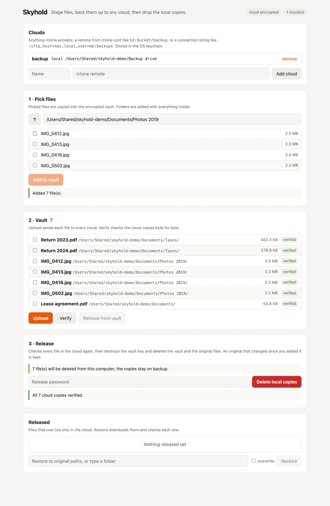
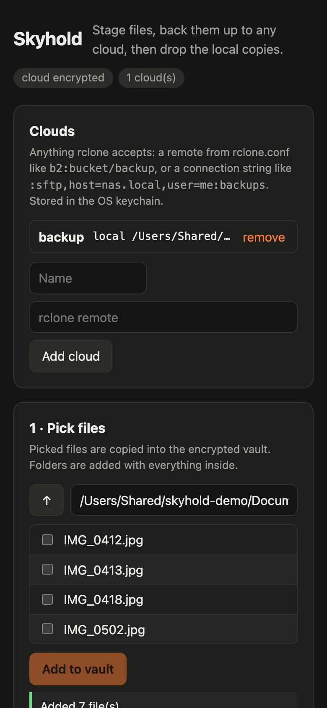

<div align="center">

# Skyhold

**Stage files, back them up to any cloud, then drop the local copies.**

[How it works](#how-it-works) · [Install](#install) · [Quick start](#quick-start) · [Commands](#commands) · [Safety](#safety) · [Limits](#limits) · [Contributing](CONTRIBUTING.md)

[](https://github.com/Gitguy268/skyhold/actions/workflows/ci.yml)
[](LICENSE)
[](go.mod)




</div>

Skyhold is for files you want off your computer but not lost: old tax returns, finished projects, photo folders. You pick the files and Skyhold copies them into an encrypted local vault. It uploads them to one or more clouds and checks every cloud copy. Then, after you enter your release password, it deletes the vault and the original files. The cloud copies stay, and `skyhold restore` brings them back.

It is one Go binary with three faces: plain CLI commands, a terminal UI (run `skyhold` with no command), and a web UI on localhost (`skyhold serve`). Clouds come from [rclone](https://rclone.org), so S3, Backblaze B2, Google Drive, OneDrive, Dropbox, WebDAV, SFTP and about 60 more all work.

<!-- live-links -->
**Project page:** [gitguy268.github.io/skyhold](https://gitguy268.github.io/skyhold/) · [skyhold-nine.vercel.app](https://skyhold-nine.vercel.app)
<!-- /live-links -->

## Install with Homebrew

```sh
brew trust gitguy268/tap
brew install gitguy268/tap/skyhold
```

Installs rclone too.

<!-- run-steps:start -->
## Run it locally, step by step

1. **Install [Go](https://go.dev/dl/) 1.27** or newer.

2. **Get the code:**

   ```sh
   git clone https://github.com/Gitguy268/skyhold.git
   cd skyhold
   ```

3. **Build it** (the first build takes a few minutes):

   ```sh
   go build -trimpath -ldflags=-s -o skyhold ./cmd/skyhold
   ```

4. **Run it:**

   ```sh
   ./skyhold --help
   ```

   The [Quick start](#quick-start) section below walks through your first backup.
<!-- run-steps:end -->

## How it works

| Step | Command | What happens |
|---|---|---|
| 1. Set up | `skyhold init` | Sets the release password (stored as an argon2id hash) and shows the **cloud key** to write down |
| 2. Add a cloud | `skyhold remote add` | Saves an rclone remote; the spec goes in the OS keychain because it can hold credentials |
| 3. Stage | `skyhold add` | Encrypts each file into the vault and records its path, size, mode and SHA-256 |
| 4. Upload | `skyhold push` | Uploads every staged file to every cloud, re-encrypted with the cloud key |
| 5. Check | `skyhold verify` | Downloads each cloud copy and compares its SHA-256 (plain uploads are checked by size and MD5 when the cloud reports one) |
| 6. Release | `skyhold release` | Lists the files, asks for the password, verifies again, then deletes the vault key, the vault and the originals |
| 7. Get back | `skyhold restore` | Downloads files to their original paths (or `--to` a folder) and checks each one |

<details>
<summary><b>Two keys, kept apart</b></summary>

- The **vault key** (an [age](https://age-encryption.org) X25519 identity) encrypts the local vault. It lives only in the OS keychain: macOS Keychain, Windows Credential Manager, or Secret Service on Linux. Release deletes it, which makes any vault data left on disk unreadable.
- The **cloud key** encrypts file names and contents in the cloud through rclone crypt. It is never the vault key, so destroying the vault key cannot lock you out of your backup. `skyhold init` shows it once, and `skyhold cloud-key` shows it again. With the cloud key and the remote, `skyhold recover` restores everything on a new machine without any local state.
- `skyhold init --encrypt-cloud=false` uploads plain files instead, for clouds you already trust or want to browse.

</details>

## Install

You need Go 1.27 or newer.

```sh
go install github.com/Gitguy268/skyhold/cmd/skyhold@latest
```

Or build from a clone:

```sh
git clone https://github.com/Gitguy268/skyhold
cd skyhold
go build -trimpath -ldflags=-s -o skyhold ./cmd/skyhold
```

The first build downloads the rclone backends and takes a few minutes. The binary is about 100 MB, or about 65 MB built with `-ldflags=-s`.

## Quick start

```sh
skyhold init                                  # release password, then write down the cloud key
skyhold remote add b2 b2:my-bucket/skyhold    # any rclone remote or connection string
skyhold add ~/Documents/Taxes ~/Pictures/2019
skyhold push
skyhold verify
skyhold release                               # lists every file, then asks for the password
```

Later, or on another machine:

```sh
skyhold restore ~/Documents/Taxes                       # back to the original paths
skyhold recover --remote b2:my-bucket/skyhold --to ~/Recovered   # no local state needed
```

A remote is anything rclone accepts: a named remote from your `rclone.conf` (`skyhold remote config` runs rclone's setup), or a connection string such as `:sftp,host=nas.local,user=me:backups`. Quote values that contain `:` or `,`, for example `:s3,provider=Minio,endpoint="http://nas:9000":bucket`.

<details>
<summary><b>Terminal UI and web UI</b></summary>

Run `skyhold` with no command for the terminal UI:

| Key | Action |
|---|---|
| `a` | pick files (`space` selects, `enter` opens a folder, `a` adds) |
| `n` | add a cloud |
| `p` / `v` | upload / verify |
| `r` | release: shows the file list, then asks for the password |
| `R` | restore the selected released files |
| `d` | remove selected staged files from the vault |
| `q` | quit |

`skyhold serve` starts the web UI on `127.0.0.1:7480` and prints a URL with an access token; `--open` opens it in your browser. Every request needs the token, and requests whose `Host` header is not the listen address are refused, so other websites in the same browser cannot drive it. It works on a phone-sized screen and follows the system's dark mode.



</details>

## Commands

| Command | What it does |
|---|---|
| `skyhold init` | set the release password and create the cloud key |
| `skyhold remote add <name> <remote>` · `list` · `rm` · `config` | manage clouds |
| `skyhold add <paths>…` | copy files or folders into the vault |
| `skyhold forget <paths>…` | drop staged files from the vault (originals stay) |
| `skyhold push` | upload staged files to every cloud |
| `skyhold verify` | check every cloud copy |
| `skyhold status [--json]` | show clouds and files |
| `skyhold release` | verify, then delete the vault and the originals |
| `skyhold restore [paths]… [--to dir] [--overwrite]` | download released files |
| `skyhold recover --remote <remote> --to <dir>` | copy a whole backup to a folder on a new machine |
| `skyhold cloud-key` | show the cloud key again |
| `skyhold passwd` | change the release password |
| `skyhold serve [--addr] [--open]` | start the web UI |

`--password-stdin` reads passwords from stdin, one per line, for scripts.

<details>
<summary><b>Files and environment variables</b></summary>

| | |
|---|---|
| Home folder | `~/Library/Application Support/skyhold`, `%AppData%\skyhold` or `~/.config/skyhold`: config, manifest, vault and release receipts |
| `SKYHOLD_HOME` | use another home folder |
| `SKYHOLD_KEYRING=file` | keep keys in a `0600` file in the home folder instead of the OS keychain. This is weaker, because the keys sit next to the vault; it is meant for machines without a keychain and for tests |
| `SKYHOLD_TOKEN` | fix the web UI token instead of making a new one on every start |
| `RCLONE_CONFIG` | use another `rclone.conf` |

Each release writes a JSON receipt to `receipts/` listing what was deleted, what was kept and which clouds hold the copies. A copy of the manifest is uploaded with the files, so the cloud also records each file's original path.

</details>

## Safety

- Nothing is deleted unless every file is verified on **every** cloud at the moment of release. If a cloud copy is missing or wrong, release deletes nothing; the next `push` uploads it again.
- Release shows the exact file list before it asks for the password.
- Each original is hashed again just before deletion. An original that changed since you added it is kept, and the release report says so.
- Wrong passwords trigger an increasing delay (1 s, 2 s, 4 s … up to 5 minutes). Nothing is ever wiped automatically.
- The vault key, the cloud key and connection-string remotes live in the OS keychain. A named remote from `rclone.conf` keeps its credentials there, as rclone stores them; use [rclone's config encryption](https://rclone.org/docs/#configuration-encryption) to protect that file.

## Limits

Read this before you rely on release to make files unrecoverable.

- **Originals are ordinary files.** Destroying the vault key covers the vault, not the originals. Skyhold deletes them normally, and on SSDs a deleted file can't be guaranteed to be unrecoverable. Full-disk encryption is what protects them, so release checks for it (FileVault, BitLocker or LUKS) and warns when it is off or can't be checked.
- **Snapshots and backups keep copies.** Time Machine and its local snapshots, Windows shadow copies, System Restore and File History, and btrfs or zfs snapshots may still hold the originals. Release warns about the ones it can detect but never deletes them.
- **The cloud copy is the only copy after release.** Keep the cloud key somewhere other than this computer. Without it, encrypted cloud copies cannot be decrypted by you or anyone else.
- **Verifying encrypted copies downloads them.** rclone crypt hides the content hashes, so with cloud encryption on, every `verify` and every `release` downloads each file once to check it. On clouds that charge for downloads (egress), that costs money each time.
- **The SMB backend is left out.** Its dependency is LGPL-3.0-licensed, so it isn't compiled in. Use SFTP or WebDAV for a NAS.

## Contributing

Bug reports, ideas and pull requests are welcome. See [CONTRIBUTING.md](CONTRIBUTING.md) for building, the checks and the code layout. Please report security problems privately: see [SECURITY.md](SECURITY.md).

## License

[MIT](LICENSE) © 2026 Lucas Van De Weerd. Skyhold compiles in rclone and other third-party libraries under their own licences; [NOTICE](NOTICE) lists them.
